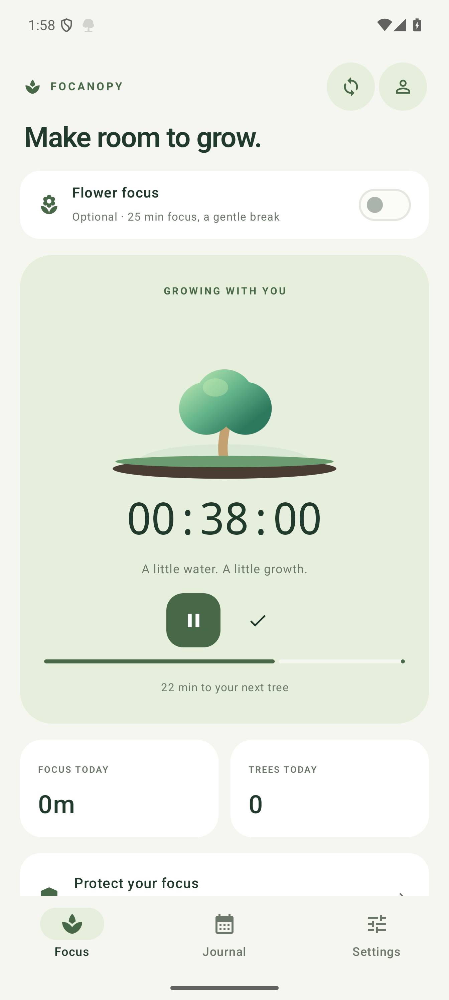
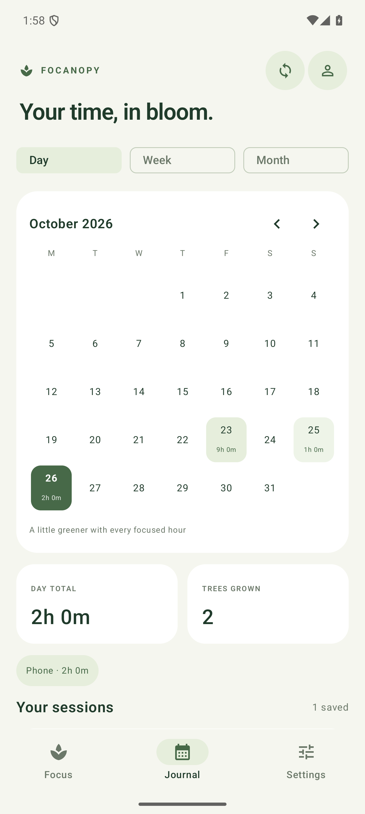
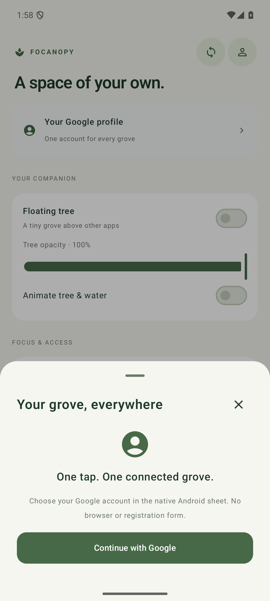
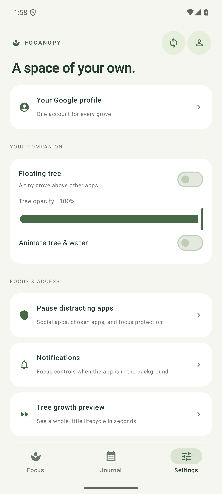
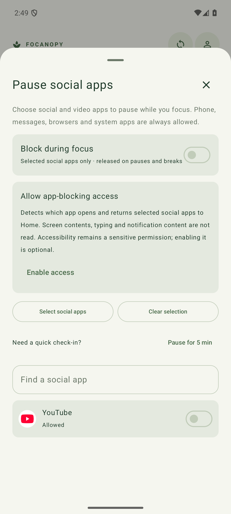
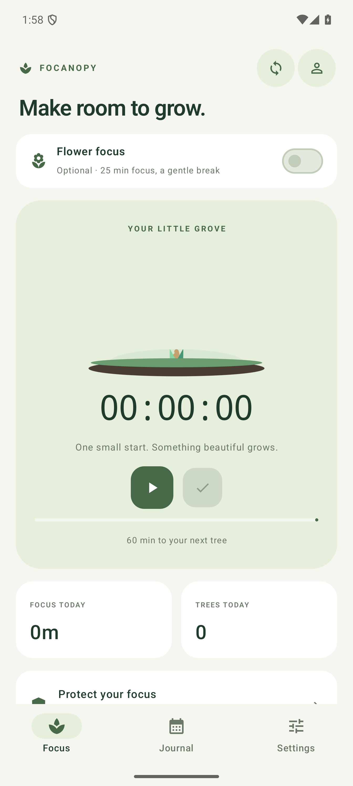
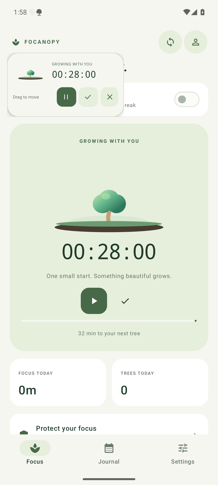

<div align="center">
  
  <h1>Focanopy</h1>
  <p><strong>Make room to grow.</strong></p>
  <p>An Android-first focus companion that turns focused time into a living grove.<br />Native apps for Android, macOS, Windows, and Linux. Offline by default.</p>
  <p>
    <a href="https://github.com/ashu-sa/cyber-cat/releases/latest">Download</a> ·
    <a href="#see-it-in-action">Demo</a> ·
    <a href="#screenshots">Screenshots</a> ·
    <a href="#build-from-source">Build from source</a>
  </p>
</div>

## See it in action

### Growing a little grove

[](https://github.com/ashu-sa/cyber-cat/releases/download/v1.14.0/focanopy-demo.mp4)

**[Watch the tree lifecycle demo · 27 seconds](https://github.com/ashu-sa/cyber-cat/releases/download/v1.14.0/focanopy-demo.mp4)** · [Download MP4](docs/media/focanopy-demo.mp4)

A native-renderer preview of gradual growth, a completed flower, overlapping trees, and a cancelled round withering. Growth is accelerated; the 2.4-second tree handoff plays at real speed. Preview time never changes your timer or saved history.

### Explore the apps

| Demo | What to try | Preview |
|---|---|---|
| **Android focus flow** | Start → pause → resume → finish → name a session → open the journal | [Focus & journal walkthrough](docs/DEMOS.md#android-focus-to-journal) |
| **Floating companion** | Show the tree, drag from the card or buttons, pause, and resume | [Floating timer](docs/DEMOS.md#android-floating-companion) |
| **Distraction blocking** | Select social apps, choose exceptions, and pause blocks for five minutes | [Focus protection](docs/DEMOS.md#android-focus-protection) |
| **Desktop apps** | Keep the tree above your work and review the calendar | [macOS, Windows & Linux](docs/DEMOS.md#native-desktop-apps) |
| **Tree lifecycle simulator** | Preview growth, completion, the next tree, and withering | [Try the built-in demo](docs/DEMOS.md#tree-lifecycle-simulator) |

## Focus, without the clutter

- **A reliable timer.** Start, pause, resume, and finish. Elapsed time comes from monotonic clocks, so switching apps does not interrupt timing.
- **A grove that grows with you.** Gradual trunk, leaf, and canopy growth; gentle watering; layered completed trees. Pausing stops watering and rests the plant.
- **Optional Flower Pomodoro.** A 25-minute focus round grows a flowering tree, followed by a 5- or 10-minute break. Each next round starts when you choose.
- **A useful journal.** A month calendar, Day/Week/Month totals, tree rewards, garden days, and per-device summaries. Rename, delete, or undo a deleted session.
- **Your companion, nearby.** Android notification controls and optional floating tree; always-on-top desktop companions with draggable, compact controls.
- **Local first, sync when you want.** Work without an account, export your history, or sign in to combine completed sessions across devices.

## Screenshots

### Android · the primary app

The primary Android experience is built with **Jetpack Compose + Material 3**: warm cream surfaces, sage-green cards, animated focus transitions, a calendar journal, and a Google profile sheet. Tap the profile icon to choose a Google account in Android’s native account sheet, without opening a browser; the icon-only sync control combines sessions from devices using the same account.

<table>
  <tr>
    <th>Focus & grow</th>
    <th>Your focus journal</th>
    <th>Google profile</th>
  </tr>
  <tr>
    <td></td>
    <td></td>
    <td></td>
  </tr>
</table>

<details>
<summary><strong>More Android screens · settings, app blocking, and the idle timer</strong></summary>

<table>
  <tr><th>Make it yours</th><th>Apps & permissions</th><th>Ready to focus</th></tr>
  <tr>
    <td></td>
    <td></td>
    <td></td>
  </tr>
</table>

The focus page scrolls on shorter screens; navigation, profile, and sync remain available. Calendar selection and page scroll positions are retained when switching tabs. [Google profile sheet](docs/screenshots/android-compose-profile.png).

</details>

### A companion above your apps

<table>
  <tr><th>Floating timer</th><th>Choose what stays outside your focus</th></tr>
  <tr>
    <td align="center"><a href="docs/screenshots/android-compose-floating.png"></a></td>
    <td align="center"><a href="docs/screenshots/android-compose-blocking.png"></a></td>
  </tr>
</table>

Drag from anywhere on the floating card; a drag does not activate its controls. App blocking is available in the optional **app-blocking APK** and requires Android Accessibility access.


### Native desktop companions

Keep a small floating tree on your desktop, then open the journal when you want the bigger picture.

<table>
  <tr><th>macOS · SwiftUI</th><th>Windows · Qt</th><th>Ubuntu · Qt</th></tr>
  <tr>
    <td align="center"></td>
    <td align="center"></td>
    <td align="center"></td>
  </tr>
  <tr>
    <td><a href="docs/screenshots/macos-journal.png"></a></td>
    <td><a href="docs/screenshots/windows-journal.png"></a></td>
    <td><a href="docs/screenshots/linux-journal.png"></a></td>
  </tr>
</table>

Screenshots come from the native apps using sample sessions, not personal activity records. Android captures show the 1.14 interface on an isolated Android 15 emulator. Desktop captures show the existing native desktop builds; the Linux images were captured on Ubuntu, not Fedora. Select a desktop journal image to inspect it at full size.

## Download & get started

| Platform | Package | Requirements |
|---|---|---|
| **Android** | [Download standard APK](https://github.com/ashu-sa/cyber-cat/releases/latest/download/Focanopy-Android-standard.apk) | Android 8.0+ |
| **macOS** | [Universal app](https://github.com/ashu-sa/cyber-cat/releases/latest/download/Focanopy-macOS-universal.zip) | macOS 14+ · Apple Silicon or Intel |
| **Windows** | [Portable ZIP](https://github.com/ashu-sa/cyber-cat/releases/latest/download/Focanopy-Windows.zip) | Windows x64 · extract the folder, then run `Focanopy.exe` |
| **Linux ARM64 · Fedora / Ubuntu** | [ARM64 AppImage](https://github.com/ashu-sa/cyber-cat/releases/latest/download/Focanopy-Linux-aarch64.AppImage) | aarch64 · glibc 2.39+ · [Fedora GNOME guide](desktop/LINUX.md) |
| **Linux Intel/AMD · Fedora / Ubuntu** | [x86-64 AppImage](https://github.com/ashu-sa/cyber-cat/releases/latest/download/Focanopy-Linux-x86_64.AppImage) | x86-64 · glibc 2.35+ · [Linux guide](desktop/LINUX.md) |

[Release notes & checksums](https://github.com/ashu-sa/cyber-cat/releases/latest) · [Build checks](https://github.com/ashu-sa/cyber-cat/actions/workflows/build.yml)

1. Open Focanopy and start the timer. On Android, allow notifications to use background controls.
2. Pause whenever you need a break. Resume to keep growing the same tree.
3. Finish, choose a category or enter a task name, and save. The app opens your journal at that session’s date.
4. Enable the floating tree or Pomodoro only if you want them. Neither is required for ordinary timing.

Android packages are debug-signed personal/testing builds, not Play Store releases. The signing identity is preserved for upgrades. macOS builds are ad-hoc signed; platform installation details are in the guides below.

### Fedora GNOME · ARM64 quick start

**[Download the ARM64 AppImage](https://github.com/ashu-sa/cyber-cat/releases/latest/download/Focanopy-Linux-aarch64.AppImage)** for a Fedora machine where `uname -m` prints `aarch64`. Python and Qt are bundled; no host Python installation is required.

From the download folder:

```bash
chmod +x Focanopy-Linux-aarch64.AppImage
./Focanopy-Linux-aarch64.AppImage
```

If FUSE is unavailable, launch without it:

```bash
./Focanopy-Linux-aarch64.AppImage --appimage-extract-and-run
```

For Intel/AMD machines (`uname -m` → `x86_64`), use the [x86-64 AppImage](https://github.com/ashu-sa/cyber-cat/releases/latest/download/Focanopy-Linux-x86_64.AppImage) instead. Each CPU architecture has its own portable build.

Both builds passed packaged X11 and native Wayland runtime checks on Fedora 43 and 44, plus Ubuntu launch checks. These are runtime checks, not full GNOME desktop certification. ARM64 requires glibc 2.39+; x86-64 requires glibc 2.35+. See the [Fedora GNOME guide](desktop/LINUX.md) for shortcuts, floating-window behaviour, and tar archive alternatives.

## How the grove works

| Mode | Growth | Completion |
|---|---|---|
| **Default timer** | The tree grows gradually throughout an hour | Each full hour adds a completed tree to the grove |
| **Flower Pomodoro** | A flowering tree grows through a 25-minute round | The completed round saves automatically, followed by a break |
| **Daily garden** | Saved sessions add up across tasks and synced devices | Eight hours of saved focus in one day earns a Garden badge |

Completed trees ease into overlapping background layers as a new seedling emerges in front. The scene keeps a stable ground surface, with bounded visible layers and exact totals in the journal.

Pomodoro has no Finish action during focus. Cancelling an unfinished round makes that tree wither and discards the partial round; earlier completed rounds remain saved. Breaks do not count as focus time, and the next focus round always waits for you.

Rewards are derived from session durations. Short sessions add up, and edits or deletions recalculate totals. Calendar days use each session’s local start date; week/month summaries count garden days separately.

**Try the animation:** open **Fast-forward tree preview** in the app. On macOS, `./macos/simulate-growth.sh` also opens a separate native simulator with pause, replay, speed, and scrubbing controls.

## Optional focus tools & sync

**Android package choice:** the standard APK omits the Accessibility service, app-blocking implementation, and installed-app inventory queries. Timing, Pomodoro, trees, history, sync, notification controls, and the optional floating tree remain available. The separate [app-blocking APK](https://github.com/ashu-sa/cyber-cat/releases/latest/download/Focanopy-Android-app-blocking.apk) declares sensitive Accessibility access and may be blocked by Play Protect when sideloaded. Do not disable Play Protect to install it. The app-blocking screenshots show this optional build.

**App blocking (optional Android build / desktop):** select social apps, choose individual apps, or block all apps except browsers and your exclusions. Android also offers a five-minute pause for blocks. Blocking works with the ordinary timer and Flower Focus, and releases during pauses and breaks. Android requires explicit Accessibility access; desktop behaviour depends on the OS. See [Pomodoro & app blocking](POMODORO.md) for setup and platform limits.

**Cross-device history:** connect the same Google account on each device. Legacy username/PIN accounts remain available in desktop clients and stay separate from Google accounts. Completed sessions sync with their source-device labels; active timers stay on their own devices. Offline edits are retained, and conflicting edits have explicit resolution choices. Existing local history uploads only when you choose to include it. See [accounts & sync](backend/README.md).

**Google sign-in:** Android uses Credential Manager’s native Google account sheet with a nonce-protected ID-token exchange. Desktop apps use Google OAuth with PKCE. Tap the profile icon to connect; login is remembered on your device. Existing username/PIN accounts remain separate. See [setup and verification](backend/GOOGLE_SIGN_IN.md).

<details>
<summary><strong>Desktop keyboard shortcuts</strong></summary>

| Action | macOS | Windows / Ubuntu GNOME |
|---|---|---|
| Show/hide floating tree | ⌘R | Ctrl+R |
| Start/resume | ⌘S | Ctrl+S |
| Pause | ⌘P | Ctrl+P |
| Finish a default-timer session | ⌘F | Ctrl+F |

Start/pause/finish shortcuts are active only while the floating tree is visible. Ubuntu/GNOME requires enabling the app’s Ctrl shortcuts once. Wayland can restrict placement and always-on-top behaviour; see the [desktop guide](desktop/README.md).

</details>

## Under the hood

| Area | Implementation |
|---|---|
| Android | Kotlin · Jetpack Compose / Material 3 · Canvas tree · foreground service · system chronometer · optional WindowManager overlay |
| macOS | Swift · SwiftUI · MenuBarExtra · floating NSPanel |
| Windows & Ubuntu | Python · PySide6 / Qt Widgets |
| Timing & animation | Monotonic elapsed-time clocks · deterministic vector growth · continuous grove handoffs |
| Local storage | Private JSON history, atomic writes/checkpoints, and history export |
| Cloud sync | Supabase · PostgreSQL · owner-scoped RLS · stable session UUIDs · tombstones · offline changes |
| Credentials | OS-backed credential storage; the account PIN is not stored on the device |
| Delivery | Per-platform GitHub Actions builds, automated checks, versioned packages, and SHA-256 manifests |

The apps render native UI. There is no Electron shell or embedded web interface.

## Build from source

Clone the repository, then use the command for your platform. Toolchain prerequisites and isolated-device test instructions are in each platform guide.

| Target | Command | Guide |
|---|---|---|
| Android | `cd android && ./gradlew :app:assembleStandard :app:testStandardUnitTest :app:lintStandard` | [Android setup](android/README.md) |
| macOS | `cd macos && ./test.sh && ./build.sh` | [macOS setup](macos/README.md) |
| Windows | `desktop\build-windows.cmd` | [Desktop setup](desktop/README.md) |
| Portable Linux | `cd desktop && ./build-appimage.sh` on Ubuntu 22.04 x86-64 / Ubuntu 24.04 ARM64 | [Linux packaging & Fedora setup](desktop/LINUX.md) |

For a universal macOS package, run the build with `CYBERCAT_UNIVERSAL=1`.

**Validation:** Android unit tests, lint, and isolated-emulator flows cover timing, notification actions, saving, journal editing, permissions, recreation, and Pomodoro. macOS model/interaction checks and Windows/Linux model/widget/packaged checks run separately. Grove tests verify continuity at completion boundaries and reduced-motion behaviour.

<details>
<summary><strong>Platform notes & compatibility</strong></summary>

- Android Force stop, reboot, or OEM battery management can stop the foreground service. Reopen the app to restore its checkpoint. Physical-device OEM restrictions and Play Store review have not been validated.
- PIN accounts have no email recovery. Local-only mode remains available.
- Focanopy was previously named **Cyber Cat**. The repository URL and internal package/storage identifiers stay stable to preserve upgrades, accounts, and history.

</details>

## License

[MIT](LICENSE) for application source. Desktop dependencies retain their own licenses; see [third-party notices](desktop/THIRD_PARTY.md).
