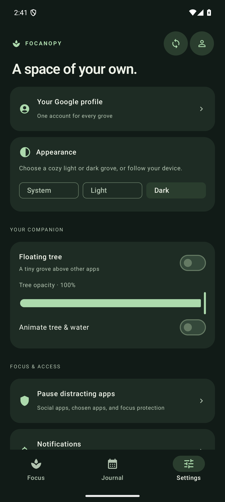

# Focanopy app demos

[← Back to the README](../README.md) · [Download the apps](https://github.com/ashu-sa/focanopy/releases/latest)

These walkthroughs use the real native app screens. Android screenshots show version 1.14 with sample sessions on an isolated Android 15 emulator. They do not show a live Google account or a completed Google consent flow.

## Android: focus to journal

1. Open **Focus**. The ordinary timer is the default; **Flower focus** is optional.
2. Tap **Play** to start. The plant grows with your elapsed focus time.
3. Tap **Pause** to rest the plant, then **Play** to resume the same session.
4. Tap **Finish**, choose a suggested task category or enter your own name, and save.
5. The app opens **Journal**. Inspect the calendar, Day/Week/Month totals, device labels, and tree counts. Use a session’s options to rename or delete it.

<table>
<tr><th>Ready</th><th>Growing</th><th>Saved time</th></tr>
<tr>
<td></td>
<td></td>
<td></td>
</tr>
</table>

For a Pomodoro demo, enable **Flower focus** before starting. Each 25-minute round completes a flowering tree and saves automatically. Choose a five- or ten-minute break; the next focus round waits for you. Cancelling an unfinished round withers that tree and discards the partial round.

## Android: floating companion

1. Open **Settings → Floating tree** and allow **Display over other apps** in Android Settings.
2. Return to Focanopy and show the companion.
3. Drag the card using the tree, timer, or button area. A drag moves it without triggering a button.
4. Use the square **Play/Pause**, **Finish**, and **Hide** icons. Hiding the card keeps an active timer running; notification controls remain available.
5. Adjust opacity and animation in Settings.

The Finish action is unavailable during a Pomodoro focus round. Some system or security-sensitive screens may hide overlays.

## Android: focus protection

Use the **app-blocking APK** for this demo. The standard APK intentionally excludes the Accessibility blocker and installed-app inventory.

1. Open **Settings → Pause distracting apps**.
2. Turn on **Block during focus**, then grant Accessibility access yourself in Android Settings.
3. Use **Select social apps**, individual app switches, or **All apps except browsers** with exclusions.
4. Start an ordinary focus timer or Flower Focus. Opening a selected app returns to Home.
5. Choose **Pause for 5 min** to temporarily allow apps without stopping your timer, or **Resume blocks** to restore protection early.
6. Pause the focus timer or enter a Pomodoro break: apps are allowed again.

Blocking returns selected apps to Home; it does not suspend or uninstall packages. Keep Play Protect enabled. See [Android setup and limitations](../android/README.md).

## Android: appearance

Open **Settings → Appearance** and choose **System**, **Light**, or **Dark**. The choice is saved across restarts and updates the main app, sheets, system bars and floating companion. You can change it during an active timer without losing time.

## Android: profile and sync

Tap the profile icon, then **Continue with Google**. Android opens its native Google account sheet; Focanopy does not launch a browser. The device needs Google Play services and a Google account. Login is remembered; the sync-arrows icon uploads and downloads completed sessions from the same account across devices.

The screenshot shows the app’s profile sheet, not Google’s account picker. Real account consent and cross-device sign-in still need user verification on a Google-enabled device. [Google configuration](../backend/GOOGLE_SIGN_IN.md).

## Native desktop apps

Show the floating companion, start a session, pause/resume it, and save a named task. Open the journal to see calendar totals and sessions. On macOS use **⌘R** to show/hide the tree; Windows/Linux use **Ctrl+R**, subject to desktop shortcut setup.

<table>
<tr><th>macOS · SwiftUI</th><th>Windows · Qt</th><th>Linux · Qt</th></tr>
<tr>
<td></td>
<td></td>
<td></td>
</tr>
<tr>
<td></td>
<td></td>
<td></td>
</tr>
</table>

Linux screenshots were captured on Ubuntu. Fedora GNOME ARM64 and x86-64 packages are available separately; see the [Fedora guide](../desktop/LINUX.md) for Wayland placement and shortcut limits.

## Tree lifecycle simulator

[Watch the 27-second MP4](https://github.com/ashu-sa/focanopy/releases/download/v1.14.0/focanopy-demo.mp4) · [Repository video](media/focanopy-demo.mp4)

The recording uses the native desktop tree renderer, with accelerated growth and the real-speed 2.4-second handoff between trees. It demonstrates growth, flowering, overlapping completed trees and withering. It is a renderer demo, not a recording of a complete timer session.

Try it yourself without changing your timer or history:

- **Android:** Focus → **Watch your grove grow**. Pause, replay, or scrub the lifecycle.
- **macOS:** open the app’s tree preview, or run `./macos/simulate-growth.sh` from the repository for a separate native simulator.
- **Windows/Linux:** open the tree-growth preview from the app.
